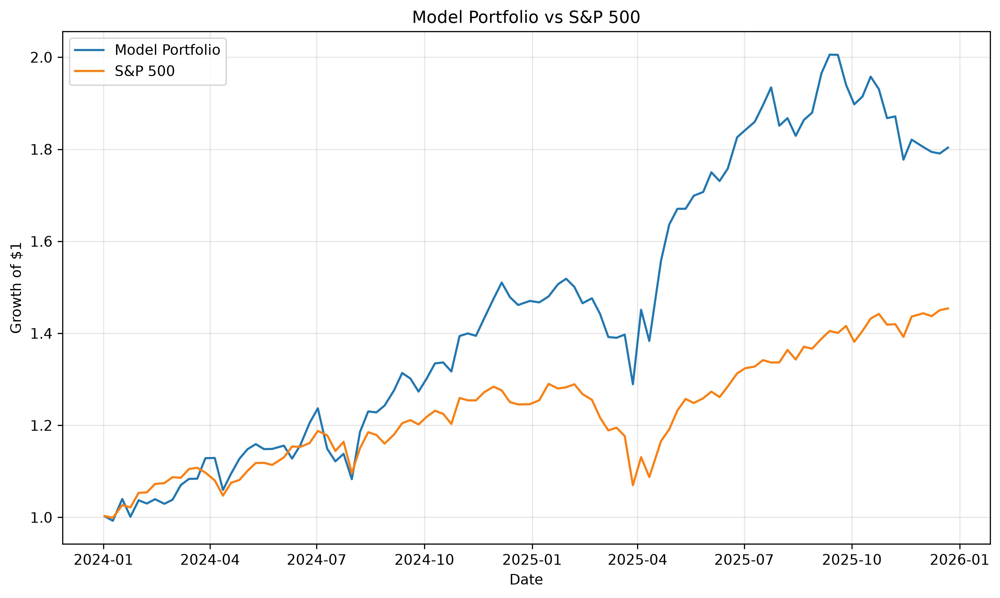

# AI Investment Analysis

A Python machine learning project exploring whether historical market indicators can help predict short-term equity outperformance.

The project was inspired by my participation in the JPMorganChase x AmplifyME MarketMind Challenge and investigates how quantitative models can complement human judgement in financial-market forecasting.

## Project Objective

The project asks:

> Can simple machine learning models use historical market indicators to identify stocks that are more likely to outperform the S&P 500 over the following five trading days?

The analysis uses a small universe of large US equities across multiple sectors and compares model predictions against the S&P 500 benchmark.

## Features

The models use four historical market indicators:

- Daily return
- 5-day momentum
- 20-day volatility
- 20-day moving-average ratio

The prediction target is:

- `1` — stock outperforms the S&P 500 over the next five trading days
- `0` — stock does not outperform the S&P 500

## Models

Two models were compared:

- Logistic Regression
- Random Forest

A time-based train/test split was used rather than random shuffling to reduce look-ahead bias.

### Model Results

| Model | Accuracy | ROC-AUC |
|---|---:|---:|
| Majority-class baseline | 53.54% | — |
| Logistic Regression | 51.33% | 0.4874 |
| Random Forest | 51.81% | 0.4889 |

Neither model beat the simple classification baseline, suggesting that the selected technical indicators alone do not provide reliable short-term classification power.

## Portfolio Backtest

The Random Forest was also used as a ranking model.

At each rebalance date:

1. Stocks were ranked by predicted probability of outperforming the S&P 500.
2. The top three stocks were selected.
3. The portfolio was equally weighted.
4. Positions were held for five trading days.
5. Rebalancing used non-overlapping five-day periods.

### Backtest Results

Over 100 non-overlapping five-day periods during 2024–2025:

- Average model portfolio return: **0.62%**
- Average S&P 500 return: **0.40%**
- Average excess return: **0.22%**
- Portfolio outperformance rate: **53%**
- Model portfolio cumulative return: **76.03%**
- S&P 500 cumulative return: **45.40%**
- Model portfolio maximum drawdown: **-16.16%**
- S&P 500 maximum drawdown: **-17.07%**
- Excess-return p-value: **0.2791**

Although the model-selected portfolio produced higher cumulative returns in the backtest, the excess return was not statistically significant. The result should therefore be interpreted as encouraging rather than evidence of a reliable market-beating strategy.



## Key Takeaways

The project highlighted several important lessons:

- Strong classification accuracy is not guaranteed in noisy financial markets.
- Portfolio ranking can still be interesting even when classification accuracy is weak.
- Time-based evaluation is essential for avoiding unrealistic look-ahead bias.
- Backtest outperformance should not automatically be interpreted as evidence of genuine predictive skill.
- Statistical significance, drawdown and benchmark comparison matter alongside raw returns.

## Limitations

This project is intentionally small and exploratory.

Important limitations include:

- Only ten stocks are included.
- The stock universe was selected in advance.
- Transaction costs and slippage are excluded.
- The model uses only price-based technical indicators.
- The backtest covers only 2024–2025 out-of-sample data.
- The excess return was not statistically significant.

## Project Structure

```text
AI-Investment-Analysis/
├── data/
├── results/
│   └── backtest_performance.png
├── src/
│   ├── backtest.py
│   ├── data_loader.py
│   ├── dataset_builder.py
│   ├── features.py
│   ├── model.py
│   └── random_forest.py
├── tests/
│   └── test_features.py
├── .gitignore
├── pytest.ini
├── README.md
└── requirements.txt